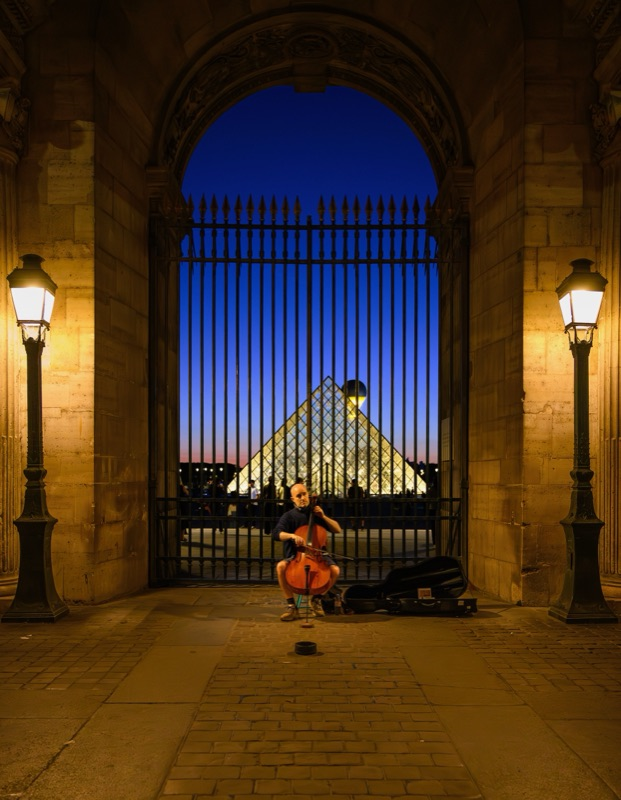
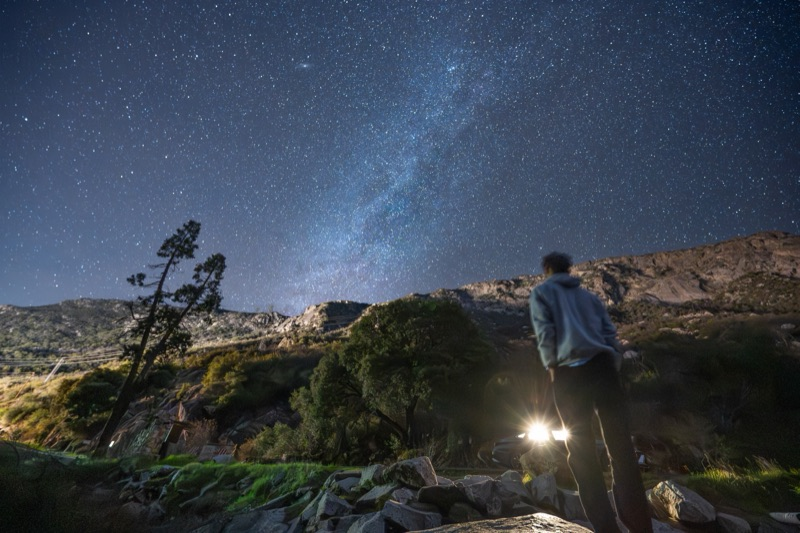
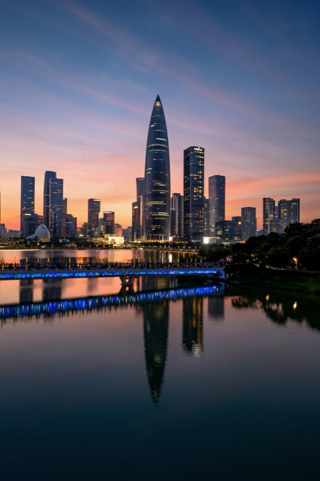
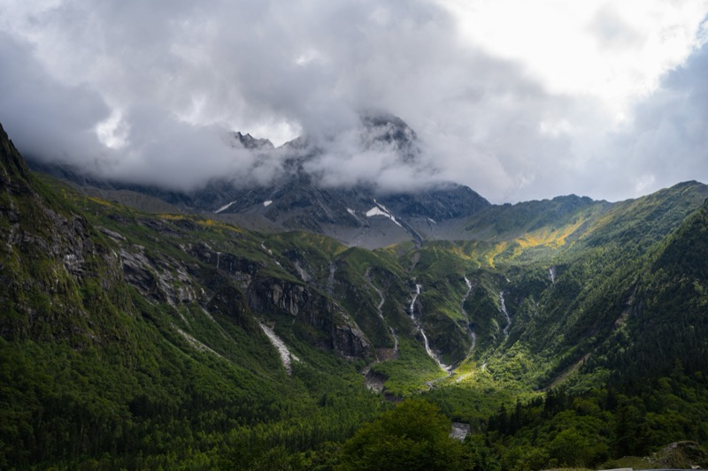
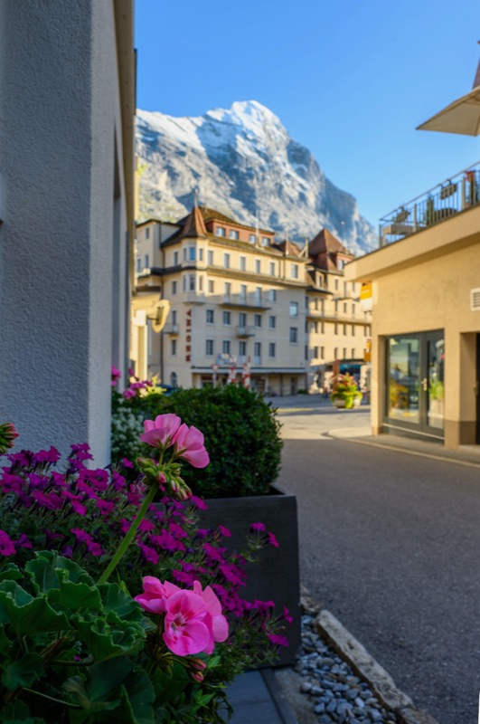
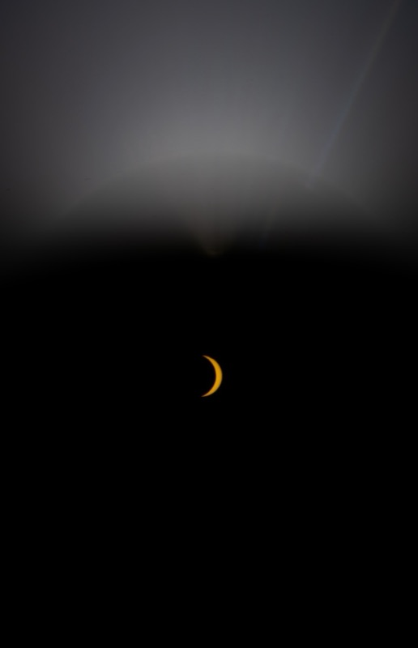

```{=html}
<p class="photo-count mono">26 photographs, 2022–2026</p>
<div class="photo-grid" data-columns="3">
<figure class="photo-item">
  <a class="lightbox photo-item__link" href="assets/photos/full/2025-08-31-01.jpg" data-gallery="photos"
     data-desc-position="bottom" data-description="&lt;span class=&quot;photo-lb__meta&quot;&gt;2025-08-31&lt;/span&gt;">
    
  </a>
  <figcaption class="photo-cap"><span class="photo-cap__meta">2025-08-31</span></figcaption>
</figure>
<figure class="photo-item">
  <a class="lightbox photo-item__link" href="assets/photos/full/2025-08-25-01.jpg" data-gallery="photos"
     data-desc-position="right" data-description="&lt;span class=&quot;photo-lb__meta&quot;&gt;2025-08-25&lt;/span&gt;">
    
  </a>
  <figcaption class="photo-cap"><span class="photo-cap__meta">2025-08-25</span></figcaption>
</figure>
<figure class="photo-item">
  <a class="lightbox photo-item__link" href="assets/photos/full/2024-11-17-01.jpg" data-gallery="photos"
     data-desc-position="right" data-description="&lt;span class=&quot;photo-lb__meta&quot;&gt;2024-11-17&lt;/span&gt;">
    
  </a>
  <figcaption class="photo-cap"><span class="photo-cap__meta">2024-11-17</span></figcaption>
</figure>
<figure class="photo-item">
  <a class="lightbox photo-item__link" href="assets/photos/full/2026-04-21-01.jpg" data-gallery="photos"
     data-desc-position="bottom" data-description="&lt;span class=&quot;photo-lb__meta&quot;&gt;2026-04-21&lt;/span&gt;">
    
  </a>
  <figcaption class="photo-cap"><span class="photo-cap__meta">2026-04-21</span></figcaption>
</figure>
<figure class="photo-item">
  <a class="lightbox photo-item__link" href="assets/photos/full/2024-11-22-01.jpg" data-gallery="photos"
     data-desc-position="right" data-description="&lt;span class=&quot;photo-lb__meta&quot;&gt;2024-11-22&lt;/span&gt;">
    
  </a>
  <figcaption class="photo-cap"><span class="photo-cap__meta">2024-11-22</span></figcaption>
</figure>
<figure class="photo-item">
  <a class="lightbox photo-item__link" href="assets/photos/full/2025-12-17-01.jpg" data-gallery="photos"
     data-desc-position="bottom" data-description="&lt;span class=&quot;photo-lb__meta&quot;&gt;2025-12-17&lt;/span&gt;">
    
  </a>
  <figcaption class="photo-cap"><span class="photo-cap__meta">2025-12-17</span></figcaption>
</figure>
<figure class="photo-item">
  <a class="lightbox photo-item__link" href="assets/photos/full/2024-10-22-01.jpg" data-gallery="photos"
     data-desc-position="right" data-description="&lt;span class=&quot;photo-lb__meta&quot;&gt;2024-10-22&lt;/span&gt;">
    
  </a>
  <figcaption class="photo-cap"><span class="photo-cap__meta">2024-10-22</span></figcaption>
</figure>
<figure class="photo-item">
  <a class="lightbox photo-item__link" href="assets/photos/full/2024-12-16-01.jpg" data-gallery="photos"
     data-desc-position="bottom" data-description="&lt;span class=&quot;photo-lb__meta&quot;&gt;2024-12-16&lt;/span&gt;">
    
  </a>
  <figcaption class="photo-cap"><span class="photo-cap__meta">2024-12-16</span></figcaption>
</figure>
<figure class="photo-item">
  <a class="lightbox photo-item__link" href="assets/photos/full/2025-12-18-01.jpg" data-gallery="photos"
     data-desc-position="bottom" data-description="&lt;span class=&quot;photo-lb__meta&quot;&gt;2025-12-18&lt;/span&gt;">
    
  </a>
  <figcaption class="photo-cap"><span class="photo-cap__meta">2025-12-18</span></figcaption>
</figure>
<figure class="photo-item">
  <a class="lightbox photo-item__link" href="assets/photos/full/2025-04-14-01.jpg" data-gallery="photos"
     data-desc-position="bottom" data-description="&lt;span class=&quot;photo-lb__meta&quot;&gt;2025-04-14&lt;/span&gt;">
    
  </a>
  <figcaption class="photo-cap"><span class="photo-cap__meta">2025-04-14</span></figcaption>
</figure>
<figure class="photo-item">
  <a class="lightbox photo-item__link" href="assets/photos/full/2023-09-04-01.jpg" data-gallery="photos"
     data-desc-position="right" data-description="&lt;span class=&quot;photo-lb__meta&quot;&gt;2023-09-04&lt;/span&gt;">
    
  </a>
  <figcaption class="photo-cap"><span class="photo-cap__meta">2023-09-04</span></figcaption>
</figure>
<figure class="photo-item">
  <a class="lightbox photo-item__link" href="assets/photos/full/2026-07-12-01.jpg" data-gallery="photos"
     data-desc-position="right" data-description="&lt;span class=&quot;photo-lb__meta&quot;&gt;2026-07-12&lt;/span&gt;">
    
  </a>
  <figcaption class="photo-cap"><span class="photo-cap__meta">2026-07-12</span></figcaption>
</figure>
<figure class="photo-item">
  <a class="lightbox photo-item__link" href="assets/photos/full/2026-08-27-01.jpg" data-gallery="photos"
     data-desc-position="bottom" data-description="&lt;span class=&quot;photo-lb__meta&quot;&gt;2026-08-27&lt;/span&gt;">
    
  </a>
  <figcaption class="photo-cap"><span class="photo-cap__meta">2026-08-27</span></figcaption>
</figure>
<figure class="photo-item">
  <a class="lightbox photo-item__link" href="assets/photos/full/2026-08-28-01.jpg" data-gallery="photos"
     data-desc-position="bottom" data-description="&lt;span class=&quot;photo-lb__meta&quot;&gt;2026-08-28&lt;/span&gt;">
    
  </a>
  <figcaption class="photo-cap"><span class="photo-cap__meta">2026-08-28</span></figcaption>
</figure>
<figure class="photo-item">
  <a class="lightbox photo-item__link" href="assets/photos/full/2026-08-29-01.jpg" data-gallery="photos"
     data-desc-position="bottom" data-description="&lt;span class=&quot;photo-lb__meta&quot;&gt;2026-08-29&lt;/span&gt;">
    
  </a>
  <figcaption class="photo-cap"><span class="photo-cap__meta">2026-08-29</span></figcaption>
</figure>
<figure class="photo-item">
  <a class="lightbox photo-item__link" href="assets/photos/full/2024-06-10-01.jpg" data-gallery="photos"
     data-desc-position="bottom" data-description="&lt;span class=&quot;photo-lb__meta&quot;&gt;2024-06-10&lt;/span&gt;">
    
  </a>
  <figcaption class="photo-cap"><span class="photo-cap__meta">2024-06-10</span></figcaption>
</figure>
<figure class="photo-item">
  <a class="lightbox photo-item__link" href="assets/photos/full/2025-03-17-01.jpg" data-gallery="photos"
     data-desc-position="right" data-description="&lt;span class=&quot;photo-lb__meta&quot;&gt;2025-03-17&lt;/span&gt;">
    
  </a>
  <figcaption class="photo-cap"><span class="photo-cap__meta">2025-03-17</span></figcaption>
</figure>
<figure class="photo-item">
  <a class="lightbox photo-item__link" href="assets/photos/full/2026-03-15-01.jpg" data-gallery="photos"
     data-desc-position="bottom" data-description="&lt;span class=&quot;photo-lb__meta&quot;&gt;2026-03-15&lt;/span&gt;">
    
  </a>
  <figcaption class="photo-cap"><span class="photo-cap__meta">2026-03-15</span></figcaption>
</figure>
<figure class="photo-item">
  <a class="lightbox photo-item__link" href="assets/photos/full/2025-09-01-01.jpg" data-gallery="photos"
     data-desc-position="right" data-description="&lt;span class=&quot;photo-lb__meta&quot;&gt;2025-09-01&lt;/span&gt;">
    
  </a>
  <figcaption class="photo-cap"><span class="photo-cap__meta">2025-09-01</span></figcaption>
</figure>
<figure class="photo-item">
  <a class="lightbox photo-item__link" href="assets/photos/full/2024-04-09-01.jpg" data-gallery="photos"
     data-desc-position="right" data-description="&lt;span class=&quot;photo-lb__meta&quot;&gt;2024-04-09&lt;/span&gt;">
    
  </a>
  <figcaption class="photo-cap"><span class="photo-cap__meta">2024-04-09</span></figcaption>
</figure>
<figure class="photo-item">
  <a class="lightbox photo-item__link" href="assets/photos/full/2024-12-29-01.jpg" data-gallery="photos"
     data-desc-position="bottom" data-description="&lt;span class=&quot;photo-lb__meta&quot;&gt;2024-12-29&lt;/span&gt;">
    
  </a>
  <figcaption class="photo-cap"><span class="photo-cap__meta">2024-12-29</span></figcaption>
</figure>
<figure class="photo-item">
  <a class="lightbox photo-item__link" href="assets/photos/full/2022-10-29-01.jpg" data-gallery="photos"
     data-desc-position="bottom" data-description="&lt;span class=&quot;photo-lb__meta&quot;&gt;2022-10-29&lt;/span&gt;">
    
  </a>
  <figcaption class="photo-cap"><span class="photo-cap__meta">2022-10-29</span></figcaption>
</figure>
<figure class="photo-item">
  <a class="lightbox photo-item__link" href="assets/photos/full/2026-10-24-01.jpg" data-gallery="photos"
     data-desc-position="bottom" data-description="&lt;span class=&quot;photo-lb__meta&quot;&gt;2026-10-24&lt;/span&gt;">
    
  </a>
  <figcaption class="photo-cap"><span class="photo-cap__meta">2026-10-24</span></figcaption>
</figure>
<figure class="photo-item">
  <a class="lightbox photo-item__link" href="assets/photos/full/2026-10-24-02.jpg" data-gallery="photos"
     data-desc-position="right" data-description="&lt;span class=&quot;photo-lb__meta&quot;&gt;2026-10-24&lt;/span&gt;">
    
  </a>
  <figcaption class="photo-cap"><span class="photo-cap__meta">2026-10-24</span></figcaption>
</figure>
<figure class="photo-item">
  <a class="lightbox photo-item__link" href="assets/photos/full/2026-10-24-03.jpg" data-gallery="photos"
     data-desc-position="bottom" data-description="&lt;span class=&quot;photo-lb__meta&quot;&gt;2026-10-24&lt;/span&gt;">
    
  </a>
  <figcaption class="photo-cap"><span class="photo-cap__meta">2026-10-24</span></figcaption>
</figure>
<figure class="photo-item">
  <a class="lightbox photo-item__link" href="assets/photos/full/2026-10-24-04.jpg" data-gallery="photos"
     data-desc-position="right" data-description="&lt;span class=&quot;photo-lb__meta&quot;&gt;2026-10-24&lt;/span&gt;">
    
  </a>
  <figcaption class="photo-cap"><span class="photo-cap__meta">2026-10-24</span></figcaption>
</figure>
</div>
```
