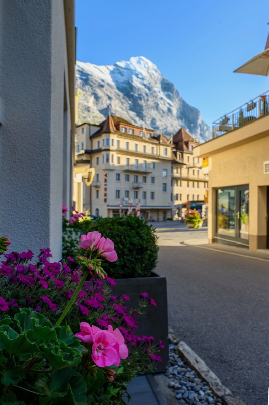
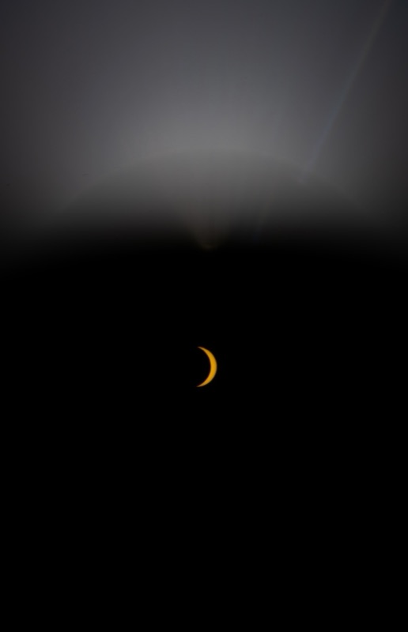

```{=html}
<p class="photo-count mono">21 photographs, 2023–2026</p>
<div class="photo-grid" data-columns="3">
<figure class="photo-item">
  <a class="lightbox photo-item__link" href="assets/photos/full/2025-08-31-01.jpg" data-gallery="photos"
     data-desc-position="bottom" data-glightbox="description: 2025-08-31">
    
  </a>
  <figcaption class="photo-cap"><span class="photo-cap__meta"><span></span><span>2025-08-31</span></span></figcaption>
</figure>
<figure class="photo-item">
  <a class="lightbox photo-item__link" href="assets/photos/full/2025-08-25-01.jpg" data-gallery="photos"
     data-desc-position="right" data-glightbox="description: 2025-08-25">
    
  </a>
  <figcaption class="photo-cap"><span class="photo-cap__meta"><span></span><span>2025-08-25</span></span></figcaption>
</figure>
<figure class="photo-item">
  <a class="lightbox photo-item__link" href="assets/photos/full/2024-11-17-01.jpg" data-gallery="photos"
     data-desc-position="right" data-glightbox="description: 2024-11-17">
    
  </a>
  <figcaption class="photo-cap"><span class="photo-cap__meta"><span></span><span>2024-11-17</span></span></figcaption>
</figure>
<figure class="photo-item">
  <a class="lightbox photo-item__link" href="assets/photos/full/2026-04-21-01.jpg" data-gallery="photos"
     data-desc-position="bottom" data-glightbox="description: 2026-04-21">
    
  </a>
  <figcaption class="photo-cap"><span class="photo-cap__meta"><span></span><span>2026-04-21</span></span></figcaption>
</figure>
<figure class="photo-item">
  <a class="lightbox photo-item__link" href="assets/photos/full/2024-11-22-01.jpg" data-gallery="photos"
     data-desc-position="right" data-glightbox="description: 2024-11-22">
    
  </a>
  <figcaption class="photo-cap"><span class="photo-cap__meta"><span></span><span>2024-11-22</span></span></figcaption>
</figure>
<figure class="photo-item">
  <a class="lightbox photo-item__link" href="assets/photos/full/2025-12-17-01.jpg" data-gallery="photos"
     data-desc-position="bottom" data-glightbox="description: 2025-12-17">
    
  </a>
  <figcaption class="photo-cap"><span class="photo-cap__meta"><span></span><span>2025-12-17</span></span></figcaption>
</figure>
<figure class="photo-item">
  <a class="lightbox photo-item__link" href="assets/photos/full/2024-10-22-01.jpg" data-gallery="photos"
     data-desc-position="right" data-glightbox="description: 2024-10-22">
    
  </a>
  <figcaption class="photo-cap"><span class="photo-cap__meta"><span></span><span>2024-10-22</span></span></figcaption>
</figure>
<figure class="photo-item">
  <a class="lightbox photo-item__link" href="assets/photos/full/2024-12-16-01.jpg" data-gallery="photos"
     data-desc-position="bottom" data-glightbox="description: 2024-12-16">
    
  </a>
  <figcaption class="photo-cap"><span class="photo-cap__meta"><span></span><span>2024-12-16</span></span></figcaption>
</figure>
<figure class="photo-item">
  <a class="lightbox photo-item__link" href="assets/photos/full/2025-12-18-01.jpg" data-gallery="photos"
     data-desc-position="bottom" data-glightbox="description: 2025-12-18">
    
  </a>
  <figcaption class="photo-cap"><span class="photo-cap__meta"><span></span><span>2025-12-18</span></span></figcaption>
</figure>
<figure class="photo-item">
  <a class="lightbox photo-item__link" href="assets/photos/full/2025-04-14-01.jpg" data-gallery="photos"
     data-desc-position="bottom" data-glightbox="description: 2025-04-14">
    
  </a>
  <figcaption class="photo-cap"><span class="photo-cap__meta"><span></span><span>2025-04-14</span></span></figcaption>
</figure>
<figure class="photo-item">
  <a class="lightbox photo-item__link" href="assets/photos/full/2023-09-04-01.jpg" data-gallery="photos"
     data-desc-position="right" data-glightbox="description: 2023-09-04">
    
  </a>
  <figcaption class="photo-cap"><span class="photo-cap__meta"><span></span><span>2023-09-04</span></span></figcaption>
</figure>
<figure class="photo-item">
  <a class="lightbox photo-item__link" href="assets/photos/full/2026-07-12-01.jpg" data-gallery="photos"
     data-desc-position="right" data-glightbox="description: 2026-07-12">
    
  </a>
  <figcaption class="photo-cap"><span class="photo-cap__meta"><span></span><span>2026-07-12</span></span></figcaption>
</figure>
<figure class="photo-item">
  <a class="lightbox photo-item__link" href="assets/photos/full/2026-08-27-01.jpg" data-gallery="photos"
     data-desc-position="bottom" data-glightbox="description: 2026-08-27">
    
  </a>
  <figcaption class="photo-cap"><span class="photo-cap__meta"><span></span><span>2026-08-27</span></span></figcaption>
</figure>
<figure class="photo-item">
  <a class="lightbox photo-item__link" href="assets/photos/full/2026-08-28-01.jpg" data-gallery="photos"
     data-desc-position="bottom" data-glightbox="description: 2026-08-28">
    
  </a>
  <figcaption class="photo-cap"><span class="photo-cap__meta"><span></span><span>2026-08-28</span></span></figcaption>
</figure>
<figure class="photo-item">
  <a class="lightbox photo-item__link" href="assets/photos/full/2026-08-29-01.jpg" data-gallery="photos"
     data-desc-position="bottom" data-glightbox="description: 2026-08-29">
    
  </a>
  <figcaption class="photo-cap"><span class="photo-cap__meta"><span></span><span>2026-08-29</span></span></figcaption>
</figure>
<figure class="photo-item">
  <a class="lightbox photo-item__link" href="assets/photos/full/2024-06-10-01.jpg" data-gallery="photos"
     data-desc-position="bottom" data-glightbox="description: 2024-06-10">
    
  </a>
  <figcaption class="photo-cap"><span class="photo-cap__meta"><span></span><span>2024-06-10</span></span></figcaption>
</figure>
<figure class="photo-item">
  <a class="lightbox photo-item__link" href="assets/photos/full/2025-03-17-01.jpg" data-gallery="photos"
     data-desc-position="right" data-glightbox="description: 2025-03-17">
    
  </a>
  <figcaption class="photo-cap"><span class="photo-cap__meta"><span></span><span>2025-03-17</span></span></figcaption>
</figure>
<figure class="photo-item">
  <a class="lightbox photo-item__link" href="assets/photos/full/2026-03-15-01.jpg" data-gallery="photos"
     data-desc-position="bottom" data-glightbox="description: 2026-03-15">
    
  </a>
  <figcaption class="photo-cap"><span class="photo-cap__meta"><span></span><span>2026-03-15</span></span></figcaption>
</figure>
<figure class="photo-item">
  <a class="lightbox photo-item__link" href="assets/photos/full/2025-09-01-01.jpg" data-gallery="photos"
     data-desc-position="right" data-glightbox="description: 2025-09-01">
    
  </a>
  <figcaption class="photo-cap"><span class="photo-cap__meta"><span></span><span>2025-09-01</span></span></figcaption>
</figure>
<figure class="photo-item">
  <a class="lightbox photo-item__link" href="assets/photos/full/2024-04-09-01.jpg" data-gallery="photos"
     data-desc-position="right" data-glightbox="description: 2024-04-09">
    
  </a>
  <figcaption class="photo-cap"><span class="photo-cap__meta"><span></span><span>2024-04-09</span></span></figcaption>
</figure>
<figure class="photo-item">
  <a class="lightbox photo-item__link" href="assets/photos/full/2024-12-29-01.jpg" data-gallery="photos"
     data-desc-position="bottom" data-glightbox="description: 2024-12-29">
    
  </a>
  <figcaption class="photo-cap"><span class="photo-cap__meta"><span></span><span>2024-12-29</span></span></figcaption>
</figure>
</div>
```
