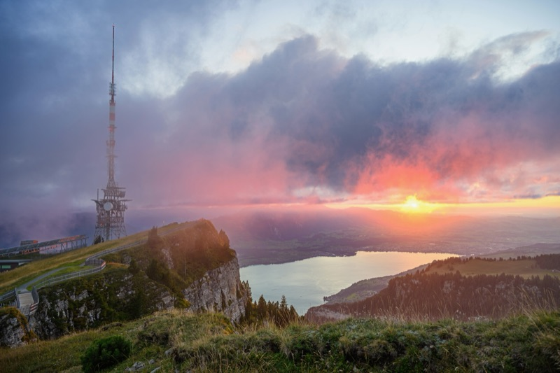
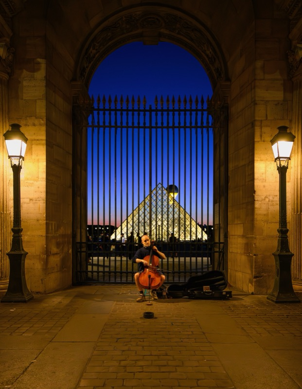
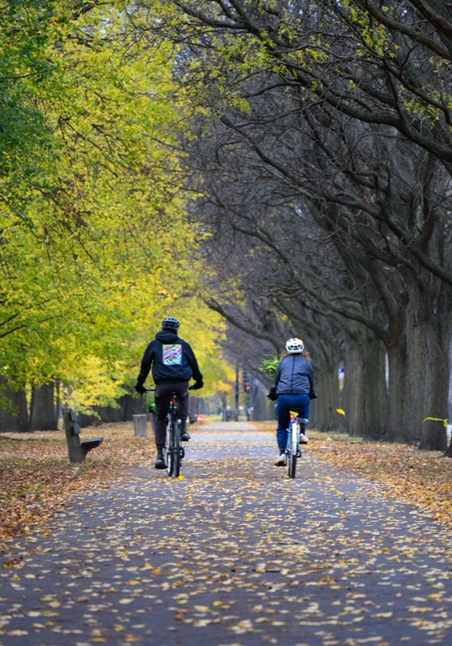
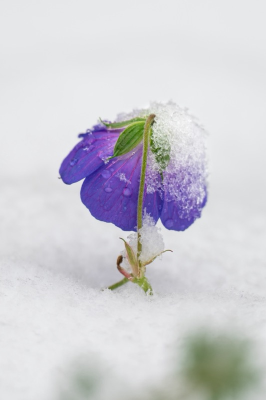
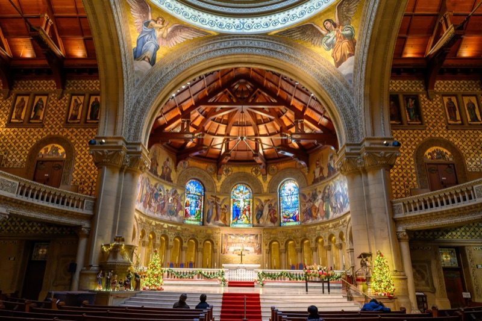

```{=html}
<section class="photo-strip">
<div class="sechead">
  <h2>Photographs</h2><span class="mono">2022–2026</span>
</div>
<div class="photo-strip__rows">
  <div class="photo-strip__row">
    <a class="photo-strip__item" href="photography.html#2025-08-31-01" style="--ar: 1.50094; aspect-ratio: 800 / 533" aria-label="Photograph, 2025-08-31 — open in gallery"></a>
    <a class="photo-strip__item" href="photography.html#2025-08-25-01" style="--ar: 0.77625; aspect-ratio: 621 / 800" aria-label="Photograph, 2025-08-25 — open in gallery"></a>
    <a class="photo-strip__item" href="photography.html#2024-11-17-01" style="--ar: 0.70000; aspect-ratio: 560 / 800" aria-label="Photograph, 2024-11-17 — open in gallery"></a>
  </div>
  <div class="photo-strip__row">
    <a class="photo-strip__item" href="photography.html#2026-04-21-01" style="--ar: 1.60000; aspect-ratio: 800 / 500" aria-label="Photograph, 2026-04-21 — open in gallery"></a>
    <a class="photo-strip__item" href="photography.html#2024-11-22-01" style="--ar: 0.66625; aspect-ratio: 533 / 800" aria-label="Photograph, 2024-11-22 — open in gallery"></a>
    <a class="photo-strip__item" href="photography.html#2025-12-17-01" style="--ar: 1.50094; aspect-ratio: 800 / 533" aria-label="Photograph, 2025-12-17 — open in gallery"></a>
  </div>
</div>
<p class="photo-strip__more"><a href="photography.html">View all photos →</a></p>
</section>
```
