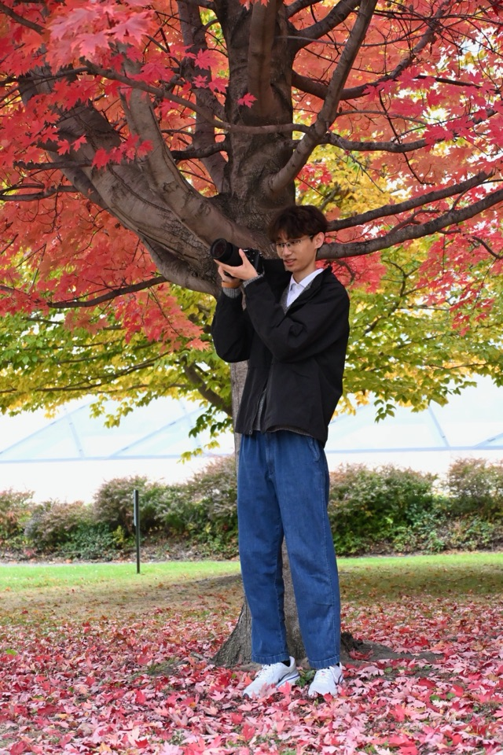

```{=html}
<figure class="about-portrait">
  
</figure>
```

I am an undergraduate student at the University of Chicago, double majoring in Statistics and Physics.

I am interested in using statistical reasoning, computation, and visualization to understand real-world problems.

This page is currently under construction.

:::: {.content-hidden}
<!--
Education: not on the page until it has an entry. Write one line per school
in this form, then delete this block's opening and closing :::: lines.

- [School · degree]{.what} [years]{.when}
-->
::: {.about-list}
## Education
:::
::::

:::: {.content-hidden}
<!--
Experience: as Education, one line per role, and it stays off the page until
it has one.

- [Role · organisation]{.what} [years]{.when}
-->
::: {.about-list}
## Experience
:::
::::

:::: {.content-hidden}
<!--
Beyond statistics: not on the page until it has text. Write one or two
sentences in place of each comment, delete any entry left without them, then
delete this block's opening and closing :::: lines. The marks are the navbar's
own, drawn by reference from assets/html/marks.html.
-->
::: {.about-pursuits}
## Beyond statistics

::: {.about-pursuit}
<svg class="about-mark" viewBox="0 0 24 24" aria-hidden="true"><use href="#mark-camera"></use></svg>

**Photography** <!-- one or two sentences --> [Gallery →](photography.html)
:::

::: {.about-pursuit}
<svg class="about-mark" viewBox="0 0 24 24" aria-hidden="true"><use href="#mark-king"></use></svg>

**Chess** <!-- one or two sentences -->
:::

::: {.about-pursuit}
<svg class="about-mark" viewBox="0 0 24 24" aria-hidden="true"><use href="#mark-piano"></use></svg>

**Piano** <!-- one or two sentences -->
:::
:::
::::
