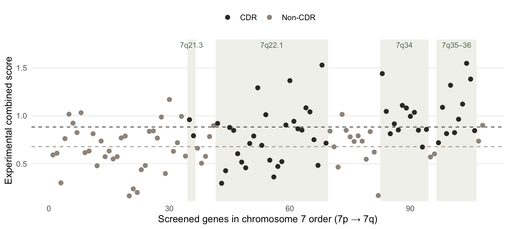

Standard statistical tests often assume independent observations. But when genes sit along the same chromosome, that assumption may not hold. This reanalysis examines whether accounting for such dependence changes the evidence for tumor-suppressor enrichment in chromosome 7's commonly deleted regions. It does not: the enrichment still holds under a test that keeps neighboring genes together.

*Data: the supplementary material of the @baeten2022 paper. Code: R script, [available on request](#code).*

## 1. A finding worth another look

Acute myeloid leukemia and **myelodysplastic syndromes**[^t-mds] are blood cancers that disrupt the body's ability to produce healthy blood cells. In the U.S. alone, about 22,700 people are expected to be diagnosed with acute myeloid leukemia in 2026.[^acs] One recurring genetic abnormality in both diseases is the loss of chromosome 7, or of part of its long arm (7q). Because such a deletion removes hundreds of genes at once, biologists have long asked which of the missing genes actually contribute to the disease.

{#fig-chr7}

Earlier studies had mapped several **commonly deleted regions**[^t-cdr] (CDRs) on chromosome 7: stretches lost again and again across patients (@fig-chr7). Building on this work, @baeten2022 took candidate genes from earlier screens and from within the CDRs, and tested them one at a time with CRISPR. They disrupted each gene in **human blood stem and progenitor cells**[^t-hspc] and measured whether the cells grew faster or became less able to mature into red blood cells. Either change suggests that the gene normally acts as a **tumor suppressor**[^t-tsg], whose loss can contribute to cancer.

The researchers combined these measurements into a single score and found that genes inside the CDRs showed significantly stronger tumor-suppressor-like effects than genes outside them (p < 0.0001). That supports an important possibility: the loss of several protective genes together, rather than of one critical gene, may help drive the disease.

Reading this, I wondered about the statistical assumption behind the result. The comparison uses a t-test, which treats each gene's score as an independent observation. But genes sit next to one another on a chromosome, and neighboring genes can share biological functions or regulatory mechanisms. What if their scores are correlated too? Then the CDR genes, packed into four stretches, would carry less independent information than the same number of unrelated genes. It is like measuring the height of 10 trees growing in two spots rather than 10 trees scattered across a forest: trees that grow side by side share the same conditions, so they tell you less about the forest as a whole. The original test might then overstate the strength of the evidence.

That led to the question behind this project: **does the finding still hold once similarities between neighboring genes are taken into account?**

## 2. Data

I use the supplementary data from @baeten2022, which gives three pieces of information for each gene: its combined experimental score, whether it lies within a CDR, and its position on chromosome 7.

After removing four experimental controls, the dataset contains 108 genes: 52 inside CDRs and 56 outside. Arranging them in chromosome order makes it possible to ask whether neighboring genes tend to have similar scores, and whether that similarity affects the original finding.

::: {.callout-note collapse="true"}
## Data cleaning and discrepancies

**Controls:** I exclude four experimental controls (AAVS1, PTEN, GATA1, and a mock well), which are not chromosome 7 candidate genes.

**A mislabeled gene:** The summary sheet lists RAC1 twice. Cross-checking against another sheet shows that the second entry is TMEM248, a screened gene otherwise missing from the summary. After correcting the label, all 112 scores, controls included, agree across the two sheets.

**Sample sizes:** The paper reports 53 CDR and 59 non-CDR genes; my cleaned dataset has 52 and 56. The paper's two counts add to 112, the 108 genes plus the four controls, and I could not fully reconcile its split with the supplementary data. Keeping the controls would weaken the result to p ≈ 0.002, while excluding them reproduces the paper's reported p < 0.0001.
:::

## 3. Method

The analysis asks three questions, in order.

**First, does the original result reproduce?** I rerun the comparison reported in the paper, a Student t-test of CDR against non-CDR scores, on the cleaned data.

**Second, do neighboring genes have similar scores?** Simply correlating neighboring genes could be misleading. CDR genes tend to score higher and sit next to each other, so neighbors might look correlated just because they belong to the same group. To check for dependence beyond this group difference, I subtract each group's average score (CDR or non-CDR) from its genes' scores. I then calculate the **lag-1 correlation**[^t-lag] between neighboring genes' remaining scores.

**Third, does the enrichment survive a test that keeps neighbors together?** If neighboring genes are positively correlated, high scores may naturally come in clusters. The CDRs could then look enriched simply because they happen to overlap some of those clusters. To see whether the actual CDR locations are unusually enriched, I compare them with alternative placements of the same CDR pattern.

Picture the 108 genes in a row, with the CDR labels marking four stretches. Slide the entire pattern of labels one gene to the right, wrapping around at the end. The genes and their scores stay fixed; only the labels move. Each stretch keeps its length and its distance from the others. Repeat for every possible shift (108 in total), and calculate the difference in average scores between labeled CDR and non-CDR genes each time.

![How the circular-shift test works. Each dot represents a gene, with higher dots indicating higher experimental scores. In the original placement (top), the shaded CDR regions cover several high-scoring genes, producing an average score difference of +0.38 between CDR and non-CDR genes. After shifting the CDR labels four positions to the right (bottom), the shifted regions now cover lower-scoring genes, and the difference drops to −0.10. The gene scores never change — only which genes are labeled as CDR. By comparing all possible placements, we can ask whether the real CDR locations capture unusually high-scoring genes. This simplified illustration uses 16 hypothetical genes and two CDR stretches; the actual analysis uses 108 genes and four.](images/fig_shift_diagram.png){#fig-shift-diagram}

If high-scoring genes naturally cluster together, some of these other placements may also produce large differences. Because the test keeps both the neighboring gene scores and the CDR stretches intact, it asks whether the actual CDR locations stand out even against these alternatives. This is a **circular-shift test**[^t-shift]. Shuffling the labels at random instead would break the four stretches into scattered single genes, and with them the neighbor structure the test is meant to keep.

The circular-shift p-value is the fraction of placements that produce a difference at least as large as the observed one, including the original placement:

$$
p_{\text{shift}} = \frac{\text{number of shifts with a difference} \geq \text{the observed difference}}{\text{total number of shifts}}.
$$

## 4. Results

### The original result reproduces

{#fig-scores}

Genes inside the CDRs average 0.88 on the combined score, against 0.68 for genes outside, a difference of 0.20. The Student t-test gives $p = 7.5 \times 10^{-5}$, consistent with the paper's reported p < 0.0001. The original finding reproduces on the cleaned data.

### Neighboring genes show modest correlation

Before any adjustment, the correlation between neighboring genes' scores is 0.28. After removing the CDR and non-CDR group averages, it falls to 0.21 (nominal p = 0.03).[^nominal]

Some similarity between neighboring genes therefore remains even after the overall difference between CDR and non-CDR genes is accounted for. The correlation is modest, but it raises a fair concern: could treating these genes as independent make the original test overly confident?

### The real CDR placement ranks first

{#fig-shift}

Among all 108 placements, the real one produces the largest difference in average scores (0.20); the next largest is 0.17. Only the real placement reaches a difference this large, so the circular-shift p-value is 1/108 ≈ 0.009, the smallest this test can return. Even with the neighbor structure preserved, the real CDR positions stand out from every alternative.

## 5. What this means

The main finding is reassuring: the enrichment of tumor-suppressor-like activity within CDRs survives a test that preserves the observed neighbor structure. Although neighboring genes show some correlation, the actual CDR positions still produce a larger difference than any of the 107 alternative placements.

The two p-values, however, should not be compared directly. The t-test's $7.5 \times 10^{-5}$ comes from a model that assumes independent observations, while the circular-shift test's 0.009 compares the real CDR placement with a limited set of alternatives. The second is not a corrected version of the first, and its resolution is capped by the 108 possible shifts.

What the analysis supports is therefore a narrower conclusion: **the CDR enrichment is robust to this particular way of accounting for neighboring genes.**

::: {.callout-note collapse="true"}
## Additional statistical checks

**Distributional assumptions:** A rank-based Wilcoxon test also finds a difference between CDR and non-CDR genes ($p = 1.5 \times 10^{-4}$). The original result is therefore not driven by the t-test's normality assumption, although the Wilcoxon test does not address dependence between genes either.

**Direction of the comparison:** A two-sided version of the circular-shift test, counting differences at least as extreme in either direction, still finds the original placement to be the only qualifying shift.

**Uncertainty in the neighbor correlation:** The residual correlation of 0.21 is estimated from 107 adjacent pairs and should not be read as a precise measure of dependence. The circular-shift test does not need this estimate: it keeps the observed sequence of scores intact, whatever its correlation.
:::

## 6. Limitations

**Experimental design:** The screen's plate layout was not balanced between CDR and non-CDR genes. In the supplement's plate-by-plate growth data, one plate held 51 CDR genes and no non-CDR genes, another held 56 non-CDR genes and a single CDR gene, and the remaining five held both. Each plate's measurements are normalized to its own AAVS1 control, but any plate-to-plate difference left over would line up with the CDR comparison. This is a different problem from neighbor correlation: a plate effect would already be built into the scores, so no rearrangement of the labels can remove it. Assessing it would need a separate look at the plate-level data and the experimental design, which this reanalysis does not attempt.

**Methodological assumptions:** The circular-shift test keeps the observed sequence of scores intact, but preserving that structure is not the same as guaranteeing that every comparison is fair. The test assumes that, without a real CDR effect, any shifted placement would be as good a reference as the original. If scores ran systematically higher in one part of the chromosome, moving the CDR pattern there would not be a fair comparison. Genes are also spaced by their order along the chromosome, not by physical distance: inside the 7q22.1 region, 28 screened genes sit within about 2 million base pairs, while outside the CDRs consecutive screened genes can be more than 10 million base pairs apart. Dependence between genes that are not neighbors, through a shared pathway or regulator, is not addressed at all.

## 7. Code and data {#code}

This reanalysis uses the supplementary data from @baeten2022. The complete analysis is a single R script that reproduces the statistical tests and generates both results figures.

**Code:** The R script is being prepared for public release and will be linked here. It is available on request in the meantime.

**Data:** Available in the supplementary materials of @baeten2022.

[^t-mds]: A group of blood cancers in which the bone marrow fails to produce enough healthy blood cells. Some cases progress to acute leukemia.
[^t-cdr]: A stretch of a chromosome that is repeatedly missing in the cancer cells of different patients. The paper uses four, all on 7q.
[^t-hspc]: Early blood-forming cells that can multiply and develop into mature blood cells.
[^t-tsg]: A gene that helps prevent uncontrolled cell growth. Losing its function can contribute to cancer.
[^t-lag]: The correlation between consecutive values in an ordered sequence. Here, the sequence is the genes arranged by chromosome position.
[^t-shift]: A statistical test that keeps the sequence of gene scores fixed while shifting the CDR labels as one pattern, preserving their arrangement.

[^acs]: American Cancer Society, [Key Statistics for Acute Myeloid Leukemia](https://www.cancer.org/cancer/types/acute-myeloid-leukemia/about/key-statistics.html), estimate for 2026.
[^nominal]: Each gene appears in two neighboring pairs, so the 107 pairs are not independent observations, and the standard p-value for this correlation is only approximate.

## References

::: {#refs}
:::
